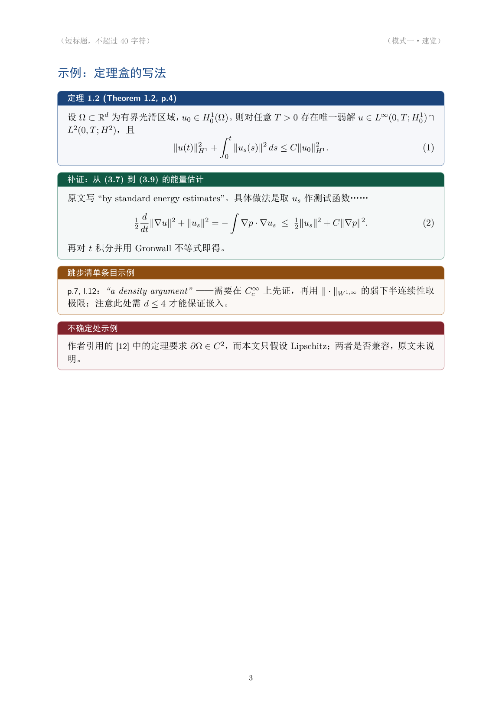

# Well-Posed（适定）

[](https://github.com/1260709663/well-posed/actions/workflows/ci.yml)
[](LICENSE)
[](CHANGELOG.md)
[](https://agentskills.io/specification)

> 一个"适定"的数学论文阅读工具：**读得准、问得对、不胡说**。

名字取自 Hadamard 的适定性——存在、唯一、稳定。正好对应它的三种产出：速览给"存在性判断"（这篇值不值得读），精读给"唯一确定的证明链"，导师提问给"稳定的自测"。

输入一篇 PDE 论文 PDF，输出**排版好的中文 PDF**（LaTeX 编译，公式是排版级的，可打印、可批注）。



> **维护状态**：v1.2.1（2026-10-19）。变更见 [CHANGELOG](CHANGELOG.md)，参与方式见 [CONTRIBUTING](CONTRIBUTING.md)。
> 发现某个模式在真实论文上失效，欢迎开 issue——**带论文名与页码的最小复现最有价值**。

---

## 为什么需要它

读数学论文有三个反复出现的坑，这个工具专门对付它们：

**1. PDF 里的公式是坏的。**
老版 pdfTeX 生成的论文，文本层直接把 TeX 字体槽位映射成 Unicode：

```
抽出来：  Btu " ∆u`Bpu, uq
实际是：  ∂_t u = Δu + B(u,u)
```

（`\partial`→`B`，`=`→`"`，`+`→`` ` ``，`(`→`p`，`)`→`q`）
文字叙述还能读，公式全错，而且错得很隐蔽。本工具会**自动检测**这种情况，强制改走"渲染页面 + 视觉重读"，并把定理陈述逐条对着图片核对。

**2. "by a standard argument" 掩盖的地方，正是读不下去的地方。**
精读模式把跳步分成三类分别处理：常规估计一句话带过；需要具体计算（分部积分、常数追踪）逐步写全；引用外部结果的，**必须写出被引定理的准确形式并逐条核对条件**——条件不匹配就是真 gap，明确标出来。

**3. 期刊分区和作者履历，模型记的往往是错的。**
这类硬事实必须联网查，且必须标来源与查询日期。查不到就写"未检索到"，绝不用"大约 2 区"糊过去。

---

## 三种模式

| 模式 | 产出 | 干什么 |
|---|---|---|
| **A 速览** | `01_brief.pdf`（4–7 页） | 主要定理清单（完整陈述）、论文骨架、技术路线、结果强度评估、期刊水平、作者介绍、读法建议 |
| **B 精读** | `02_deepread.pdf`（15–30 页） | 阅读地图、记号表、预备工具、逐节精读、**补全跳过的证明**、跳步清单、核心参考文献 3–5 篇、可攻击点 |
| **C 提问** | `03_tutor.pdf`（20–28 题） | 四层追问：设定与记号 / 定理理解 / 证明技术 / 边界与推广，每题附参考答案、典型误区、一句追问 |

三种模式共用一套解析与排版管线，可以单独跑，也可以一次跑全套。

---

## 安装

本工具是一个 agent skill，靠 `SKILL.md` 被识别。直接克隆到 skills 目录：

```bash
# 用户级（所有项目可用）
git clone https://github.com/<your-name>/well-posed.git ~/.workbuddy/skills/well-posed

# 或项目级
git clone https://github.com/<your-name>/well-posed.git .workbuddy/skills/well-posed
```

## 依赖：三种档位，缺东西也能用

先跑 `python scripts/doctor.py` 自检，它会告诉你本机属于哪一档，并给出安装命令。

| 档位 | 条件 | 产出 | 内容质量 |
|---|---|---|---|
| **full** | Python 3.9+ / PyMuPDF / xelatex + `ctex` `tcolorbox` 等 | 排版好的 **PDF** | 完整 |
| **markdown-only** | 有 Python + PyMuPDF，但没装 LaTeX | **Markdown** | 完整（公式、结构、标记都在，只是没排版） |
| **host-read-only** | 连 PyMuPDF 都没有 | **Markdown** | 完整但更保守：失去公式编码检测，定理一律以页面视觉内容为准 |

也就是说：**没装 LaTeX 不会让你失去内容，只失去排版**；连 Python 都没有，也还能靠 agent 自身的 PDF 阅读能力干活。

### 安装

```bash
# 只补解析能力（markdown-only → full 的第一步）
python -m pip install pymupdf

# 补 LaTeX（按平台选一个）
winget install --id MiKTeX.MiKTeX                  # Windows（已验证此 ID）
# 或 TinyTeX 官方脚本：irm https://yihui.org/tinytex/install-bin-windows.ps1 | iex
brew install --cask mactex-no-gui                  # macOS
sudo apt install texlive-xetex texlive-lang-chinese texlive-latex-extra   # Ubuntu
```

TinyTeX 是最小安装，缺宏包时 `doctor.py` 会直接给出该跑的命令，例如：

```
tlmgr install ctex mathtools tcolorbox
```

自己已经装了 TeX Live 也可以，`doctor.py` 会用 `kpsewhich` 逐个检查 `ctex`、`tcolorbox`
等 8 个必需宏包在不在。**注意 tectonic 不行**——它虽然也是 TeX 引擎，但 `build_pdf.py`
调用的是 `xelatex`。

### 平台差异

- **Windows** 用模板默认的 `fontset=windows`。
- **Linux / macOS** 编译前把模板里的 `fontset=windows` 改成 `fontset=fandol`，
  否则会因为找不到 Windows 字体而失败（CI 里就是这么做的）。

已测试环境：TinyTeX（Windows）+ Python 3.13 + PyMuPDF 1.28。

---

## 用法

在支持 skill 的 agent 里上传论文 PDF，然后自然语言说：

```
读一下这篇论文，给我个速览          → 模式 A
精读这篇，把跳过的证明补出来         → 模式 B
用导师视角考考我                    → 模式 C
全流程，三份都要                    → A + B + C
```

产出会落在论文同目录的 `<论文名>_reader/` 下，**保留 `.tex`**，方便你自己改。

### 单独调用脚本

```bash
PY=python
SK=~/.workbuddy/skills/well-posed

# 1. 体检：页数、书签、文本层质量、是否扫描件、是否双栏、数学编码是否损坏
$PY $SK/scripts/prep.py info paper.pdf

# 2. 抽文本（带 [p.N] 页码标记，便于引用"原文 p.12"）
$PY $SK/scripts/prep.py text paper.pdf --pages 1-6 --clean --out t.txt

# 3. 渲染页面为 PNG（核对公式用）
$PY $SK/scripts/prep.py render paper.pdf --pages 3-5 --dpi 180 --out pages/

# 4. 编译 .tex → PDF（两遍 xelatex，失败时给出可读的报错摘要）
$PY $SK/scripts/build_pdf.py note.tex --out note.pdf
```

---

## 标记体系

精读笔记里每个推导都带标签，绝不混同"作者的"和"我的"：

| 标记 | 含义 |
|---|---|
| `[原文]` | 原文给出的 |
| `[补证]` | 我补出的推导（可用原文假设独立验算） |
| `[推测]` | 推断：可能与作者思路不同，或对作者意图的猜测 |
| `[gap]` | 补不出、或原文本身有疑问的地方 |
| `[坑]` | 隐含假设、边界情形、疑似笔误 |

这条规则是整个工具可信度的基础：**宁可写"我没算通"，也不凑一个看起来对的证明。**

---

## 已知限制

- **只面向数学/PDF 分析类论文**，不处理实验科学、机器学习论文。
- **扫描件**（无文本层）能处理，但要全页渲染 + 视觉读取，慢很多。
- **证明补全有边界**：常规估计与原文明示的思路能补；原作者手稿式的跳跃、或依赖未公开计算的步骤，会老实标 `[gap]` 而不是编一个。
- 期刊分区/影响因子依赖联网检索，检索不到时会明确写"未检索到"。分区表每年调整，历史论文的评价存在时间错位，工具会提示这一点。

---

## 仓库结构

```
.
├── SKILL.md                      # 入口：模式判定、5 步工作流、7 条质量红线
├── references/
│   ├── mode-brief.md             # 模式一：速览的 9 段结构与写作禁忌
│   ├── mode-deep.md              # 模式二：补证方法论（三类跳步 + 标记规则 + 排版红线）
│   ├── mode-tutor.md             # 模式三：按论文章节逐节出题的规范
│   └── sources.md                # 期刊分区/作者信息的检索规范 + 数学期刊分档参考
├── assets/
│   └── template.tex              # 中文 LaTeX 模板（四色语义盒 + 目录 + 页眉）
├── scripts/
│   ├── prep.py                   # PDF 体检 / 文本抽取 / 页面渲染
│   ├── build_pdf.py              # xelatex 两遍编译，失败给可读报错
│   ├── validate_skill.py         # 校验 SKILL.md 合规性与内部引用完整性
│   └── doctor.py                 # 环境自检：判定 full / markdown-only / host-read-only
├── .github/
│   ├── workflows/ci.yml          # 规范校验 + 模板编译（ubuntu，fandol 字体）
│   └── ISSUE_TEMPLATE/           # 问题与建议模板
├── docs/preview.png
├── Makefile                      # make check：校验 + 语法 + 模板编译
├── CHANGELOG.md
└── CONTRIBUTING.md
```

---

## 开发与维护

```bash
make check      # 规范校验 + py_compile + 模板编译，提交前跑这个
make validate   # 只校验 SKILL.md
make template   # 只编译模板
```

Windows 上没有 make 时：

```bash
python scripts/validate_skill.py .
python -m py_compile scripts/prep.py scripts/build_pdf.py scripts/validate_skill.py
python scripts/build_pdf.py assets/template.tex --out build/template.pdf
```

`scripts/validate_skill.py` 检查的是规范里那些**容易悄悄违反**的条款：

| 检查项 | 为什么重要 |
|---|---|
| `name` 为 kebab-case 且等于目录名 | 规范硬要求；不一致会导致部分宿主找不到 skill |
| `description` ≤ 1024 字符 | 超长会被截断，触发词就丢了 |
| 顶层字段是否在规范白名单内 | 扩展字段应放进 `metadata`，否则其他宿主可能报错 |
| 占位链接（`https://github.com/`） | 这种半填的链接会让徽章和安装命令全失效 |
| `SKILL.md` 里引用的相对路径是否存在 | 引用了不存在的 `references/xx.md` 是静默失败 |
| `SKILL.md` 篇幅 ≤ 500 行 | 规范建议正文 < 5000 tokens，超了要拆分 |

CI 在每次 push / PR 时重跑同一套检查，并额外用 `fontset=fandol` 编译一次模板
（Linux 上没有 Windows 字体，`fontset=windows` 会失败）。

---

## License

MIT

